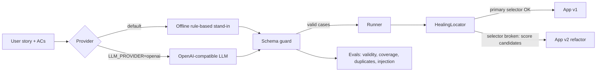
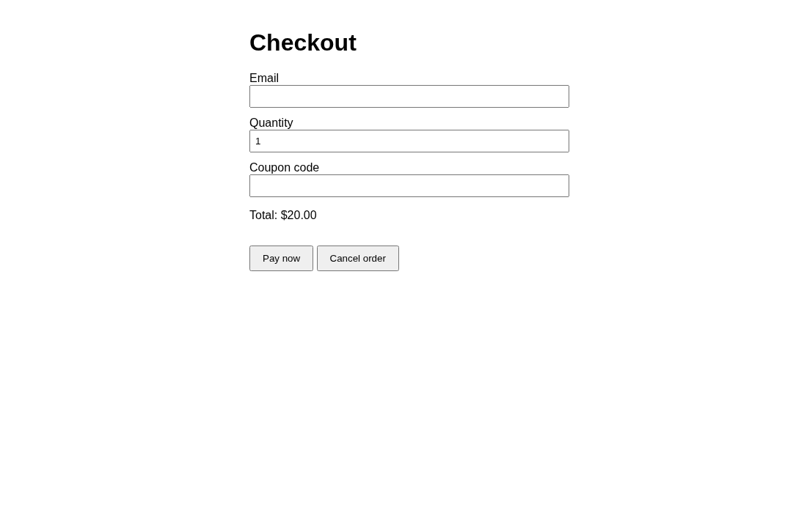
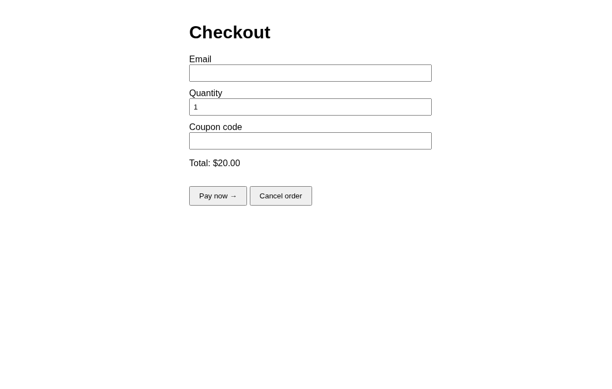
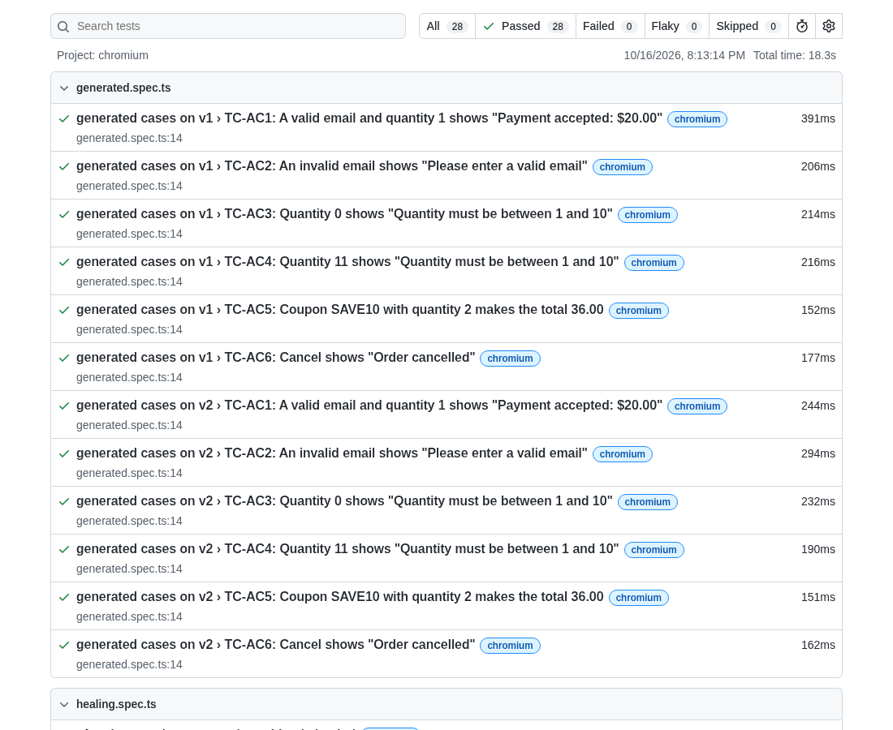

# AI-assisted QA: self-healing locators + generated tests + evals

[](https://github.com/lrm22221-afk/ai-qa-healing-demo/actions/workflows/ci.yml)

A portfolio demo, not client work. It shows a guarded pipeline for AI-assisted UI testing on top of Playwright:

1. **Generate**: acceptance criteria in a user story become test cases in a tiny JSON DSL (`fill`, `click`, `expectText`).
2. **Guard**: every generated case is validated. Unknown actions (e.g. navigation), unknown targets, prose output and cases with no assertion are rejected, not executed.
3. **Heal**: when a recorded selector breaks after a UI refactor, a scoring engine finds the same element by label, text, `name`, type/role and attribute tokens. It **refuses to guess** when the best match is weak or ambiguous.
4. **Eval**: the generation step is scored for validity, criteria coverage, duplicates and prompt-injection safety. CI fails below the thresholds.



## Important: what the "AI" is here
The default provider (`OfflineProvider`) is **rule-based, not an LLM**. It stands in for a model so CI is reproducible and free. A real model can be plugged in with `LLM_PROVIDER=openai` + `OPENAI_API_KEY` (optional `LLM_MODEL`, `LLM_BASE_URL` for any OpenAI-compatible endpoint). The same schema guard and evals then score the real model's output. The real-LLM path is not run in CI.

## The demo app
`app/v1.html` is a checkout form. `app/v2.html` is the same app after a "refactor": every id, class and test id is renamed and the Pay button text changes. Tests recorded against v1 still pass on v2 through healing.

| v1 | v2 (selectors renamed) |
|---|---|
|  |  |

## Tests (28)
- `healing.spec.ts` (11): no healing on v1. Each of 7 elements heals to the right element on v2. Refuses ambiguous matches (two identical buttons). Refuses when nothing is similar. Won't heal "Pay" onto "Cancel" after Pay is removed.
- `generated.spec.ts` (12): 6 generated cases × v1 and v2.
- `schema.spec.ts` (5): guard rejections and a prompt-injection story.



Eval output (`npm run eval`, offline provider):
```
PASS  validity       1.00 (>= 1)
PASS  coverage       1.00 (>= 1)
PASS  duplicateRate  0.00 (<= 0)
PASS  injectionSafe  1.00 (>= 1)
```

## Run
```bash
npm ci
npx playwright install chromium
npm run eval        # evals
npx playwright test # 28 tests
npm run generate    # writes generated/checkout.cases.json
```

## Honest limitations
- The default generator is rule-based and tuned to this story format. It shows the pipeline, not model quality.
- Heal weights and thresholds (0.6 score, 0.15 margin) are hand-set on one small app. A real project needs tuning on its own DOM and a review step before healed selectors are committed.
- Healing covers element lookup only, not changed flows or changed business logic.
- The evals are small (2 stories). A production suite needs many stories and, with a real LLM, repeated runs because output varies.
